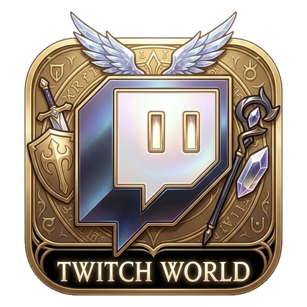

# Twitch World FF14

[English](README.md) · [Português](README.pt-BR.md) · [日本語](README.ja.md) · **Deutsch** · [Français](README.fr.md)

<p align="center"></p>

> Twitch-Chat in Final Fantasy XIV lesen und beantworten – ein Dalamud-Plugin, das du nur mit einem Link installierst.

**Twitch World** zeigt den Chat jedes Twitch-Kanals *im* Spiel (in einem eigenen Fenster und/oder in einem Tab des FFXIV-Chats, mit der Farbe jeder Person und MOD- / VIP- / SUB-Abzeichen) und lässt dich antworten, ohne das Spiel zu verlassen. Es kommt **leer**: kein Kanal, kein Konto eingerichtet. Für Streamer, Moderatoren und Zuschauer, die FFXIV spielen.

## Nur mit dem Link installieren

Kein Installer, kein Download, kein .NET. Du fügst **eine Adresse** in Dalamud ein und installierst Twitch World über die normale Plugin-Liste. Updates kommen automatisch. Funktioniert überall, wo XIVLauncher + Dalamud laufen (Windows, Linux, macOS).

```text
https://raw.githubusercontent.com/yurammaruy/twitch-world-ff14/main/repo.json
```

1. Tippe im Spielchat `/xlsettings` und drücke Enter. Das Fenster *Dalamud Settings* öffnet sich.
2. Klicke links in der Liste auf **Experimental**.
3. Scrolle zu **Custom Plugin Repositories**.
4. Klicke in das leere Textfeld und füge diese Adresse mit **Strg + V** ein:
5. Klicke rechts auf die Schaltfläche **+**. Die Adresse erscheint in der Liste.
6. Prüfe, dass das kleine **Kästchen** neben der Adresse angehakt ist.
7. Klicke unten auf **Save and Close**.
8. Tippe `/xlplugins` und drücke Enter. Der Plugin-Installer öffnet sich.
9. Klicke links im Menü auf **All Plugins**.
10. Gib im Suchfeld `Twitch World` ein.
11. Klicke auf **Install** und warte einige Sekunden.
12. Suche **Twitch World** unter **Installed Plugins** und prüfe, dass der Schalter AN ist. Du solltest das Symbol, die Version und **by Lirou** sehen.
13. Tippe `/tw-chat` im Spielchat. Das Fenster „Twitch World“ öffnet sich.

> Tipp: Wenn Strg+V nichts einfügt, kopiere die Adresse aus dem grauen Kasten oben erneut (Kopieren-Symbol rechts oben).

## Twitch-Token (nur zum Senden von Nachrichten)

**Ein Token brauchst du nur zum SENDEN von Nachrichten.** Zum bloßen Lesen brauchst du weder Konto noch Token: überspringe diesen Abschnitt. Das Token ist ein langer Text, der wie ein Passwort funktioniert: Er erlaubt dem Plugin, in deinem Namen im Chat zu schreiben. Dein Twitch-Passwort gibst du dem Plugin nie.

1. Melde dich im Browser mit dem Konto an, mit dem du chatten möchtest, und öffne **https://twitchtokengenerator.com** (eine bekannte Seite, die weder von Twitch noch von diesem Projekt betrieben wird).
2. Wähle **Bot Chat Token** (die Option für Chat-Bots). Zeigt die Seite nur eine eigene Auswahl, wähle die Berechtigungen **chat:read** und **chat:edit**. Mehr ist nicht nötig.
3. Klicke auf die Schaltfläche zum Verbinden mit Twitch. Eine Twitch-Seite fragt nach Erlaubnis. Prüfe, ob es das richtige Konto ist, und klicke auf **Authorize** (Autorisieren). Löse das Captcha, falls verlangt.
4. Zurück auf der Seite siehst du einen langen Text namens **Access Token** (eventuell auch *Refresh Token* und *Client ID*). Kopiere **nur das Access Token** (Kopieren-Schaltfläche oder markieren und Strg+C).
5. Tippe im Spiel `/tw-chat` und klicke auf **Config**. … Klicke auf **Conectar agora** (*Jetzt verbinden*). Der Status wird GRÜN: *Conectado a #Kanal como dein_name*.

📖 **[Vollständige Token-Anleitung](docs/GUIDE.DE.md#so-erhältst-du-dein-twitch-token)**

## Funktionen

- Live-Twitch-Chat im Fenster **und/oder** in einem Spiel-Chat-Tab (beliebige Linkshell oder Cross-World-Linkshell 1–8, im Guide erklärt)
- Twitch-Namensfarben (an die Spielpalette angenähert) und Abzeichen [STREAMER] [MOD] [VIP] [SUB] [BOT]
- Nachrichten, die dich erwähnen, erscheinen golden; Bot-Meldungen in Türkis
- Nur-Lesen-Modus braucht **weder Konto noch Token**; Senden mit `/tw-chat deine Nachricht`
- Blockiert Bot-Befehle (`/` und `!`), Emojis, Emotes und Links; ein Chat gleichzeitig; **keine Nachricht wird versteckt**
- Schritt-für-Schritt-Anleitung für Laien in **5 Sprachen** (English, 日本語, Deutsch, Français, Português)

## Wichtig

- Dalamud-Plugins sind laut den Nutzungsbedingungen von Square Enix **nicht erlaubt**. Dieses Plugin liest/schreibt nur Text und automatisiert nichts im Spiel, dennoch besteht ein Risiko – Nutzung auf eigene Gefahr.
- Inoffizielles Projekt. Keine Verbindung zu Square Enix, Twitch oder Dalamud. „Twitch“ und „Final Fantasy“ gehören ihren Inhabern.
- Das Twitch-Token (nur zum *Senden* nötig) ist wie ein Passwort. Niemals weitergeben.

## Hilfe / Fehler

Eröffne ein [Issue](../../issues/new/choose) und beschreibe den Schritt, an dem es scheitert (poste niemals dein Twitch-Token).

---

**Schlagwörter:** Final Fantasy XIV, FFXIV, FF14, Dalamud-Plugin, XIVLauncher, Twitch-Chat im Spiel, Twitch-Chat-Overlay, Streamer-Tool, Linkshell-Chat-Tab.

MIT License · © 2026 Lirou
