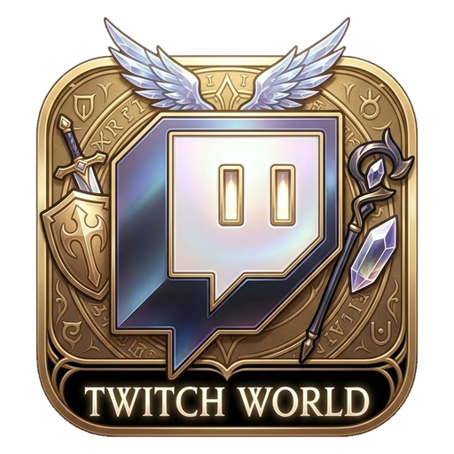

# Twitch World FF14

[English](README.md) · [Português](README.pt-BR.md) · [日本語](README.ja.md) · [Deutsch](README.de.md) · **Français**

<p align="center"></p>

> Lisez et répondez au chat Twitch dans Final Fantasy XIV — un plugin Dalamud qui s'installe avec un simple lien.

**Twitch World** affiche le chat de n'importe quelle chaîne Twitch *dans* le jeu (dans sa propre fenêtre et/ou dans un onglet du chat de FFXIV, avec la couleur de chacun et les badges MOD / VIP / SUB) et vous laisse répondre sans quitter le jeu. Il arrive **vierge** : aucune chaîne ni compte configurés. Pour les streamers, modérateurs et spectateurs qui jouent à FFXIV.

## Installer avec le seul lien

Pas d'installateur, rien à télécharger, pas de .NET. Vous collez **une adresse** dans Dalamud et installez Twitch World depuis la liste normale des plugins. Les mises à jour arrivent toutes seules. Fonctionne partout où XIVLauncher + Dalamud fonctionnent (Windows, Linux, macOS).

```text
https://raw.githubusercontent.com/yurammaruy/twitch-world-ff14/main/repo.json
```

1. Dans la zone de chat du jeu, tapez `/xlsettings` et appuyez sur Entrée. La fenêtre *Dalamud Settings* s'ouvre.
2. Dans la liste de gauche, cliquez sur **Experimental**.
3. Faites défiler jusqu'à **Custom Plugin Repositories**.
4. Cliquez dans la case de texte vide et collez cette adresse avec **Ctrl + V** :
5. Cliquez sur le bouton **+** à droite. L'adresse apparaît dans la liste.
6. Vérifiez que la petite **case à cocher** à côté de l'adresse est cochée.
7. Cliquez sur **Save and Close** en bas.
8. Tapez `/xlplugins` et appuyez sur Entrée. L'installateur de plugins s'ouvre.
9. Cliquez sur **All Plugins** dans le menu de gauche.
10. Dans la zone de recherche, tapez `Twitch World`.
11. Cliquez sur **Install** et patientez quelques secondes.
12. Trouvez **Twitch World** dans **Installed Plugins** et vérifiez que l'interrupteur est ACTIVÉ. Vous devez voir l'icône, la version et **by Lirou**.
13. Tapez `/tw-chat` dans le chat du jeu. La fenêtre « Twitch World » s'ouvre.

> Astuce : si Ctrl+V ne colle rien, copiez de nouveau l'adresse depuis la zone grise ci-dessus (bouton de copie en haut à droite).

## Fonctionnalités

- Chat Twitch en direct dans une fenêtre **et/ou** dans un onglet du chat du jeu (n'importe quel Linkshell ou Linkshell inter-mondes, de 1 à 8, expliqué dans le guide)
- Couleurs des pseudos Twitch (approchées de la palette du jeu) et badges [STREAMER] [MOD] [VIP] [SUB] [BOT]
- Les messages qui vous mentionnent apparaissent en doré ; les alertes de bots en turquoise
- Le mode lecture seule ne demande **ni compte ni jeton** ; pour écrire : `/tw-chat votre message`
- Bloque les commandes de bot (`/` et `!`), emojis, emotes et liens ; un seul chat à la fois ; **aucun message n'est masqué**
- Guide pas à pas pour débutants en **5 langues** (English, 日本語, Deutsch, Français, Português)

## Guide complet pas à pas

📖 **[Français – full step-by-step guide](docs/GUIDE.FR.md)** · [English](docs/GUIDE.EN.md) · [Português (Brasil)](docs/GUIDE.PT.md) · [日本語](docs/GUIDE.JA.md) · [Deutsch](docs/GUIDE.DE.md)

## Important

- Les plugins Dalamud ne sont **pas autorisés** par les conditions d'utilisation de Square Enix. Ce plugin ne fait que lire/écrire du texte et n'automatise rien dans le jeu, mais le risque existe — utilisation à vos risques.
- Projet non officiel. Aucun lien avec Square Enix, Twitch ou Dalamud. « Twitch » et « Final Fantasy » appartiennent à leurs propriétaires.
- Le jeton Twitch (nécessaire seulement pour *envoyer*) est comme un mot de passe. Ne le partagez jamais.

## Aide / bugs

Ouvrez une [Issue](../../issues/new/choose) et décrivez l'étape qui échoue (ne publiez jamais votre jeton Twitch).

---

**Mots-clés :** Final Fantasy XIV, FFXIV, FF14, plugin Dalamud, XIVLauncher, chat Twitch en jeu, overlay chat Twitch, outil de streamer, onglet de chat Linkshell.

MIT License · © 2026 Lirou
