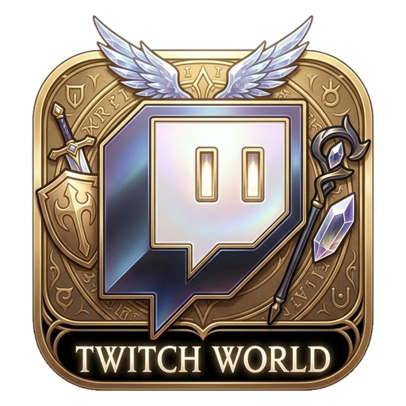

# Twitch World FF14

[English](README.md) · [Português](README.pt-BR.md) · **日本語** · [Deutsch](README.de.md) · [Français](README.fr.md)

<p align="center"></p>

> ファイナルファンタジーXIV の中で Twitch チャットを読んで返信できる Dalamud プラグイン。リンクを貼るだけでインストールできます。

**Twitch World** は、任意の Twitch チャンネルのチャットをゲーム *内* に表示します(専用ウィンドウ、または FFXIV のチャットタブに、ユーザーごとの色と MOD / VIP / SUB バッジ付きで表示)。ゲームを離れずに返信もできます。初期状態は**空**で、チャンネルもアカウントも設定されていません。FFXIV を遊ぶ配信者・モデレーター・視聴者向けです。

## リンクを貼るだけでインストール

インストーラーもダウンロードも .NET も不要です。**1 つのアドレス**を Dalamud に貼り付けるだけで、通常のプラグイン一覧から Twitch World をインストールできます。更新も自動です。XIVLauncher + Dalamud が動く環境(Windows / Linux / macOS)で使えます。

```text
https://raw.githubusercontent.com/yurammaruy/twitch-world-ff14/main/repo.json
```

1. ゲームのチャット欄に `/xlsettings` と入力して Enter を押します。*Dalamud Settings* が開きます。
2. 左の一覧で **Experimental** をクリックします。
3. **Custom Plugin Repositories** までスクロールします。
4. 空のテキスト欄をクリックし、次のアドレスを **Ctrl + V** で貼り付けます:
5. 右の **+** ボタンをクリックします。アドレスが一覧に追加されます。
6. アドレスの横の小さな**チェックボックス**がオンになっていることを確認します。
7. 下の **Save and Close** をクリックします。
8. `/xlplugins` と入力して Enter を押します。プラグインインストーラーが開きます。
9. 左のメニューで **All Plugins** をクリックします。
10. 検索欄に `Twitch World` と入力します。
11. **Install** ボタンをクリックし、数秒待ちます。
12. **Installed Plugins** で **Twitch World** を探し、スイッチがオンになっていることを確認します。アイコン、バージョン、**by Lirou** が表示されるはずです。
13. ゲームのチャットで `/tw-chat` と入力します。「Twitch World」ウィンドウが開きます。

> ヒント: Ctrl+V で何も貼り付けられない場合は、上のグレーの枠の右上のコピーボタンでもう一度コピーしてください。

## 機能

- Twitch チャットをウィンドウ **および/または** ゲームのチャットタブに表示(リンクシェルまたはクロスワールドリンクシェルの 1〜8 から選択可能、ガイドで説明)
- Twitch の名前の色(ゲームの色に近似)と [STREAMER] [MOD] [VIP] [SUB] [BOT] バッジ
- 自分宛てのメッセージは金色、ボットの通知はティール色で強調
- 閲覧のみなら**アカウントもトークンも不要**。送信は `/tw-chat メッセージ`
- ボットコマンド(`/` と `!`)、絵文字、エモート、リンクはブロック。同時接続は 1 チャットのみ。**メッセージを隠すことはありません**
- **5 言語**(English・日本語・Deutsch・Français・Português)の初心者向け手順ガイド

## 詳しい手順ガイド

📖 **[日本語 – full step-by-step guide](docs/GUIDE.JA.md)** · [English](docs/GUIDE.EN.md) · [Português (Brasil)](docs/GUIDE.PT.md) · [Deutsch](docs/GUIDE.DE.md) · [Français](docs/GUIDE.FR.md)

## 重要

- Dalamud プラグインはスクウェア・エニックスの利用規約で**許可されていません**。このプラグインは文字の読み書きのみで、ゲーム内の操作を自動化しませんが、プラグイン使用のリスクはあります。自己責任でご利用ください。
- 非公式プロジェクトです。スクウェア・エニックス、Twitch、Dalamud とは無関係です。「Twitch」「Final Fantasy」は各権利者の商標です。
- Twitch トークン(メッセージ*送信*時のみ必要)はパスワードと同じです。絶対に他人に見せないでください。

## ヘルプ / 不具合

[Issue](../../issues/new/choose) を作成し、どの手順で失敗したか書いてください(Twitch トークンは絶対に載せないでください)。

---

**キーワード:** ファイナルファンタジーXIV, FF14, FFXIV, Dalamud プラグイン, XIVLauncher, Twitch チャット, ゲーム内チャット, 配信者ツール, リンクシェル。

MIT License · © 2026 Lirou
