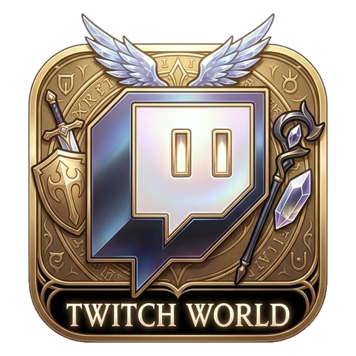

# Twitch World FF14

**English** · [Português](README.pt-BR.md) · [日本語](README.ja.md) · [Deutsch](README.de.md) · [Français](README.fr.md)

<p align="center"></p>

> Read and reply to any Twitch chat inside Final Fantasy XIV — a Dalamud plugin you install with just a link.

**Twitch World** shows the chat of any Twitch channel *inside* the game (in its own window and/or in a tab of the FFXIV chat, with each person's color and MOD / VIP / SUB badges) and lets you answer without leaving the game. It comes **clean**: no channel and no account configured. Made for streamers, mods and viewers who play FFXIV.

## Install with just the link

No installer, no download, no .NET. You paste **one address** into Dalamud and install Twitch World from the normal plugin list. Updates arrive on their own. It works anywhere XIVLauncher + Dalamud work (Windows, Linux, macOS).

```text
https://raw.githubusercontent.com/yurammaruy/twitch-world-ff14/main/repo.json
```

1. In the game chat box, type `/xlsettings` and press Enter. The *Dalamud Settings* window opens.
2. In the list on the left click **Experimental**.
3. Scroll to **Custom Plugin Repositories**.
4. Click the empty text box and paste this address with **Ctrl + V**:
5. Click the **+** button on the right. The address appears in the list.
6. Make sure the small **checkbox** next to the address is ticked.
7. Click **Save and Close** at the bottom.
8. Type `/xlplugins` and press Enter. The plugin installer opens.
9. Click **All Plugins** in the menu on the left.
10. In the search box type `Twitch World`.
11. Click the **Install** button. Wait a few seconds.
12. Find **Twitch World** in **Installed Plugins** and check that its switch is ON. You should see the icon, the version and **by Lirou**.
13. Type `/tw-chat` in the game chat. The "Twitch World" window opens.

> Tip: if Ctrl+V pastes nothing, copy the address again from the gray box above (use the copy button on its top-right corner).

## Twitch token (only to send messages)

**You only need a token to SEND messages.** To just read a chat you need no account and no token: skip this section. The token is a long text that works like a password: it lets the plugin write in chat as you. You never give your Twitch password to the plugin.

1. In your browser, log in to Twitch with the account you want to chat with, then open **https://twitchtokengenerator.com** (a well-known site that is not run by Twitch or by this project).
2. Choose **Bot Chat Token** (the option for chat bots). If the site only shows a custom list, pick the permissions **chat:read** and **chat:edit**. Nothing else is needed.
3. Click the Twitch connect button. A Twitch page asks for permission. Check that it is the right account and click **Authorize**. Solve the captcha if asked.
4. Back on the site you will see a long text called **Access Token** (there may also be a *Refresh Token* and a *Client ID*). Copy **only the Access Token** (use its copy button, or select it and press Ctrl+C).
5. In the game, type `/tw-chat` and click **Config**. … Click **Conectar agora** (*Connect now*). The status turns green: *Conectado a #channel como your_username*.

📖 **[Full token tutorial](docs/GUIDE.EN.md#how-to-get-your-twitch-token)**

## Features

- Live Twitch chat in a window **and/or** in a game chat tab (any Linkshell or Cross-world Linkshell, 1–8, explained in the guide)
- Twitch name colors (approximated to the game's palette) and [STREAMER] [MOD] [VIP] [SUB] [BOT] badges
- **Channel alerts**: raids, subs, resubs, gifted subs, bits, point redemptions and announcements show up in the chat in color, with an optional alert sound (on/off button in the window and in Settings). The sound plays only for alerts and bot messages, never for normal chat.
- Messages that mention you are highlighted in gold; bot alerts in teal
- Read-only mode needs **no account and no token**; send with `/tw-chat your message`
- Blocks bot commands (`/` and `!`), emojis, emotes and links; one chat at a time; **no message is hidden**
- Step-by-step guide for non-programmers in **5 languages** (English, 日本語, Deutsch, Français, Português)

## Important

- Dalamud plugins are **not allowed** by Square Enix's terms of service. This plugin only reads/writes text and automates nothing in the game, but the risk of using plugins exists — use at your own risk.
- Unofficial project. Not affiliated with Square Enix, Twitch or Dalamud. "Twitch" and "Final Fantasy" belong to their owners.
- The Twitch token (only needed to *send* messages) is like a password. Never share it.

## Help / bugs

Open an [Issue](../../issues/new/choose) and describe the step where it failed (never post your Twitch token).

---

**Keywords:** Final Fantasy XIV, FFXIV, FF14, Dalamud plugin, XIVLauncher, Twitch chat in game, Twitch chat overlay, streamer tool, Linkshell chat tab, 해외 / 日本語 / Deutsch / Français / Português.

MIT License · © 2026 Lirou
